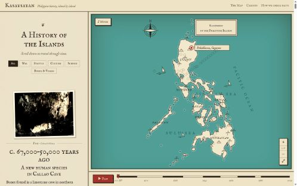
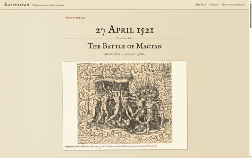

# Kasaysayan

**Live demo:** https://kasaysayan-topaz.vercel.app

*Kasaysayan* means "history" in Filipino. It's an illustrated, sourced history of the Philippines, told event by event on an old-style pictorial map of the islands.

Scroll through 60 events, from the first people in Callao Cave about 67,000 years ago to the Bangsamoro vote of 2019. As you read, each event is inked onto the map where it happened. Every event opens into a long-read story with chapters, a photo gallery, a street map of the place, and numbered sources.



## What's in it

- **60 events in 9 eras**: Pre-colonial, Spanish, Revolution, American, Japanese occupation, Third Republic, Martial Law, EDSA and Modern Times. 13 are in the Visayas and Bohol, and 4 are in Mindanao.
- **Storyteller map**: a vintage SVG map built from real Natural Earth coastlines. You can zoom, pan and pinch it, and its markers sync with the story as you scroll.
- **Timeline scale bar** with a **Play** button that steps through history on its own.
- **Topic filter**: war, politics, culture, science, and Bohol & Visayas. The filter is saved in the URL.
- **Long-read event pages**: 600–1,000 word stories in chapters, with photos placed in the text, a gallery and lightbox, a sepia OpenStreetMap mini map, and numbered sources.
- **Sources differ notes** on 20 contested events, such as Pugad Lawin, Bonifacio's death, Bataan's death toll, Plaza Miranda and the 1973 ratification.
- **250 public domain and Creative Commons photos**, each credited with its author, license and source. They're all listed on the Credits page.
- **Original music**: a slow waltz generated live with the Web Audio API. It's off by default.



## How facts are checked

Every event is checked before it goes on the site.

- **Not verified, not published:** each event file has `verified: true/false`, and drafts never appear in a production build.
- **Sources:** each event cites the sources its facts came from, and Wikipedia is never one of them.
- **Contested events:** these need at least 2 independent sources and a note saying where the sources disagree.
- **Automatic checks:** the build fails if a photo license isn't allowed, a photo file is missing, a caption is `TODO`, or a story is too short or too long.

## Stack (₱0)

| Part | Tool |
|---|---|
| Framework | Next.js 15 (static export), TypeScript, Tailwind CSS 4 |
| Content | One Markdown file per event, validated with Zod |
| Map | Custom SVG from Natural Earth (public domain), plus Leaflet + OpenStreetMap on event pages |
| Photos | Wikimedia Commons (public domain, CC0, CC BY, CC BY-SA), converted to WebP with sharp |
| Tests | Vitest + Testing Library (108 tests) |
| Hosting | Vercel Hobby (free), GitHub Actions CI (free) |

## Run it locally

```bash
npm install
npm run dev
```

Then open http://localhost:3000.

Other commands:

| Command | What it does |
|---|---|
| `npm test` | Run the unit tests |
| `npm run check` | Validate every event file and list unverified drafts |
| `npm run build` | Build the static site into `out/` |
| `npm run dev:drafts` | Dev server that also shows unverified drafts, marked "Draft" |
| `npm run new-event -- 1898 independence` | Create a new draft event from the template |
| `npm run fetch-image -- <id> "File:Title.jpg" ...` | Download licensed photos from Wikimedia Commons as WebP |
| `npm run apply-images -- manifest.json` | Download several events' photos with captions, from a JSON manifest |

## Adding an event

1. Run `npm run new-event -- <year> <slug>`. This creates `content/events/<year>-<slug>.md` with `verified: false`.
2. Research the event and fill in the frontmatter: date, era, topics, place and sources.
3. Write the story in 3 or more `## ` chapters, 600–1,500 words. Tie facts to sources with `[1]`, `[2]`, and so on.
4. Add photos with `npm run fetch-image`, then write real captions and alt text.
5. Run `npm run check`. When every fact is sourced, set `verified: true`.

## Credits

- Coastline: [Natural Earth](https://www.naturalearthdata.com/), public domain. See `docs/data-sources.md`.
- Street maps: © [OpenStreetMap](https://www.openstreetmap.org/copyright) contributors.
- Fonts: IM Fell English by Igino Marini, SIL Open Font License.
- Photos: see the site's Credits page for each photo's author and license.

## The problem I solved

See [`docs/problem-i-solved.md`](docs/problem-i-solved.md).

---

Built by [dewdew-del](https://github.com/dewdew-del).
